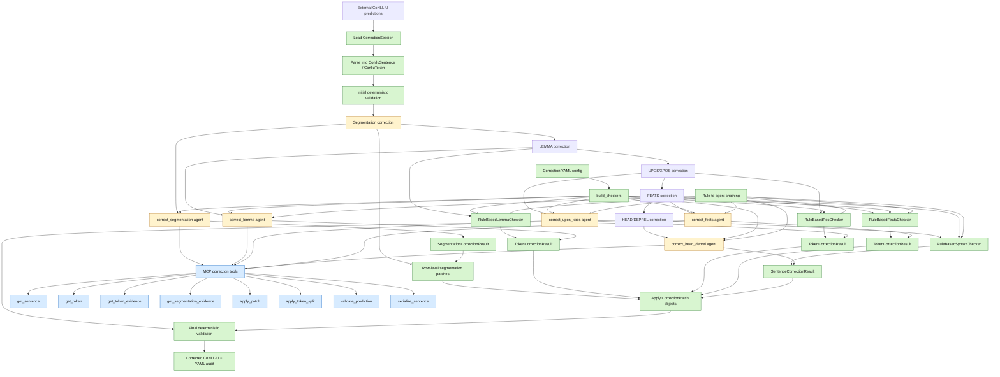

# LLM Parser Correction Pipeline

This diagram shows the planned correction workflow for externally generated
CoNLL-U predictions. Nodes are colored by implementation status and role.



## Legend

| Color | Meaning |
| --- | --- |
| Green | Implemented Python code |
| Blue | Implemented infrastructure or tool logic |
| Yellow | Partly implemented; interface exists, runtime is not complete |
| Purple | Agent role / future LLM-backed checker |
| Grey | Planned but not implemented |

## Current Status

| Area | Status | Notes |
| --- | --- | --- |
| Structured CoNLL-U model | Implemented | `ConlluSentence`, `ConlluToken` |
| Deterministic validation | Implemented | Structural checks for IDs, UPOS, HEAD, DEPREL, root count |
| Correction patches | Implemented | `CorrectionPatch` |
| Token correction results | Implemented | `TokenCorrectionResult` |
| Sentence correction results | Implemented | `SentenceCorrectionResult` |
| Token evidence bundles | Implemented | `TokenEvidence`, `TrainingEvidence` |
| Segmentation evidence bundles | Implemented | `SegmentationEvidence`, surface/subform/sequence queries |
| Segmentation row patches | Implemented | `TokenSplitPatch`, `TokenMergePatch`, `TokenInsertPatch`, `TokenDeletePatch`, `apply_segmentation_patch` |
| Rule-based lemma correction | Implemented | `RuleBasedLemmaChecker` |
| Rule-based UPOS/XPOS correction | Implemented | `RuleBasedPosChecker` |
| Rule-based FEATS correction | Implemented | `RuleBasedFeatsChecker` |
| Rule-based HEAD/DEPREL correction | Implemented | `RuleBasedSyntaxChecker` |
| Correction config | Implemented | YAML config with rule and agent settings |
| Rule to agent chaining | Implemented | `ChainedTokenChecker`, `ChainedSentenceChecker` |
| Agent checker adapters | Implemented | Runtime-neutral `AgentTokenChecker`, `AgentSentenceChecker`, `AgentSegmentationChecker` |
| Agent skills | Partly implemented | `SKILL.md` contracts exist; no real LLM runtime yet |
| MCP correction tools | Partly implemented | Tool logic and registry exist; real MCP transport not wired |
| Segmentation correction | Partly implemented | Pipeline hook and evidence exist; no linguistic segmenter yet |
| Prediction module | Not implemented | Future module for initial column-by-column prediction |

## Example Config

```yaml
segmentation:
  agent:
    skill: agents/correct_segmentation/SKILL.md
    only_when_uncertain: false

lemma:
  rule: true
  agent:
    skill: agents/correct_lemma/SKILL.md
    only_when_uncertain: true

upos_xpos:
  rule: true
  agent:
    skill: agents/correct_upos_xpos/SKILL.md
    only_when_uncertain: true

feats:
  rule: true
  agent:
    skill: agents/correct_feats/SKILL.md
    only_when_uncertain: true

head_deprel:
  rule: true
  agent:
    skill: agents/correct_head_deprel/SKILL.md
    only_when_uncertain: true
```

## Example Command

```bash
llmparser correct predictions.conllu \
  --db training-db \
  --output corrected.yml \
  --config correction.yml
```
